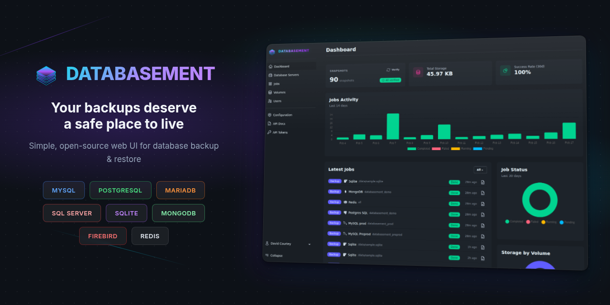

<div align="center">
  
</div>

# Databasement

Sistema autoalojado de gestión de copias de seguridad para bases de datos: MySQL, PostgreSQL, MariaDB, SQL Server, MongoDB, SQLite, Firebird y Redis.

Este repositorio es una bifurcación de trabajo personal del proyecto original [David-Crty/databasement](https://github.com/David-Crty/databasement). Incluye una paleta de colores propia (teal/slate), un menú lateral rediseñado y este README en español.

---

## Estructura del proyecto

```text
databasement/
├── app/
│   ├── Actions/              # Lógica de negocio por dominio
│   │   ├── Backups/          # CreateBackupJobAction, RunBackupAction, etc.
│   │   ├── Restores/         # RestoreAction, ScheduleRestoreAction
│   │   ├── Snapshots/        # Snapshot lifecycle actions
│   │   ├── Servers/          # Server CRUD y pruebas de conexión
│   │   ├── Volumes/          # Volúmenes local/S3/Azure/SMB/SFTP
│   │   └── Notifications/    # Canales y envío de alertas
│   ├── Livewire/             # Componentes de interfaz (clase, no Volt)
│   ├── Models/               # Modelos Eloquent con claves ULID
│   └── Providers/            # Registro de servicios
├── config/                   # Configuración Laravel
├── database/
│   ├── migrations/           # Esquema
│   └── seeders/              # Datos iniciales
├── lang/                     # Traducciones (Backup, Restore y Snapshot en inglés)
├── resources/
│   ├── css/app.css           # Tema daisyUI teal/slate personalizado
│   ├── js/                   # Entry point Vite
│   └── views/layouts/app.blade.php  # Layout con sidebar rediseñado
├── routes/                   # Web, API y canales
├── tests/                    # Suite Pest
├── docs/                     # Documentación del sitio
├── docker/                   # Imagen y entrypoint
└── .github/workflows/        # CI (tests, codecov)
```

## Cómo está realizado

**Stack**: Laravel 12 sobre PHP 8.5. Interfaz con Livewire 3 y Mary UI sobre daisyUI 5 y Tailwind CSS 4, construida con Vite. Autenticación con Fortify (OAuth Google/GitHub/GitLab/OIDC y 2FA). Autorización con Bouncer (roles, organizaciones y permisos por recurso). Tests con Pest. Documentación de API con Scramble. Claves primarias ULID.

**Arquitectura**: patrón Actions, una acción por operación en `App\Actions\<Dominio>\<Verbo><Sujeto>Action`. Livewire de clase (sin Volt). Los agentes de servidor salen por HTTPS hacia la aplicación, sin puertos de entrada. Conexión a bases de datos mediante túneles SSH (bastión, contraseña o clave). Un solo contenedor Docker con queue worker integrado.

**Motores soportados**:

| Motor | Versiones | Herramienta | Restore |
| --- | --- | --- | --- |
| MySQL | 5.5 - 26.x | mysqldump | Sí |
| MariaDB | 5.x - 12.x | mariadb-dump / mysqldump | Sí |
| PostgreSQL | 12 - 18 | pg_dump v16 / v18 | Sí |
| SQL Server | 2017 / 2019 / 2022 / Azure | sqlpackage (.dacpac) | Sí |
| MongoDB | 4.2 - 8.0 | mongodump / mongorestore | Sí |
| SQLite | 3.x | sqlite3 .backup | Sí |
| Firebird | 3.x - 5.x | gbak v5 | Sí |
| Redis | 2.8+ | redis-cli --rdb | No |
| Valkey | 7.2+ | redis-cli --rdb | No |

## Cómo se utiliza

### Docker

```bash
docker run -d --name databasement \
  -p 2226:2226 \
  -e DB_CONNECTION=sqlite \
  -e DB_DATABASE=/data/database.sqlite \
  -e ENABLE_QUEUE_WORKER=true \
  -v ./databasement-data:/data \
  davidcrty/databasement:1
```

Abre `http://localhost:2226`. Usa `PUID`/`PGID` para permisos de archivos.

### Desarrollo local

```bash
composer install
npm install
cp .env.example .env
php artisan key:generate
php artisan migrate
npm run build
php artisan serve --port=2226
```

Abre `http://localhost:2226`.

### Flujo de uso

1. Registra servidores de bases de datos (menú **Data**).
2. Configura volúmenes de destino: local, S3/MinIO, Azure Blob, SMB o SFTP.
3. Crea trabajos de **Backup**: diarios o semanales, retención simple o GFS.
4. Activa compresión (gzip/zstd) y cifrado (AES-256) según necesidad.
5. Monitorea los **Snapshots** en tiempo real desde la interfaz.
6. Restaura: entre servidores o programadas (por ejemplo producción a staging).
7. Configura notificaciones: Email, Slack, Discord, Telegram, Pushover, Gotify o Webhook.
8. Invita al equipo: usuarios, roles y permisos con Bouncer.

### Automatización

API REST documentada en `/docs/api`. Tokens de API en el menú **System**. Servidor MCP disponible para integraciones con asistentes de IA.

## Licencia

MIT. El proyecto original es de [David-Crty](https://github.com/David-Crty).
